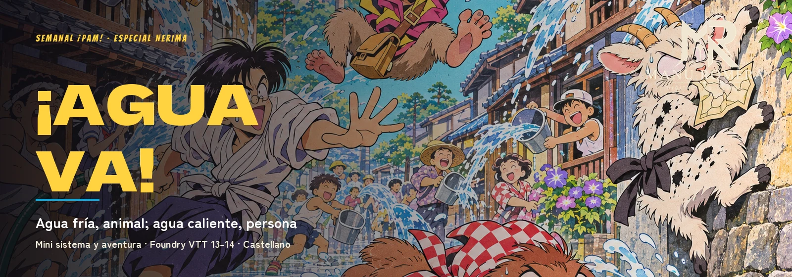
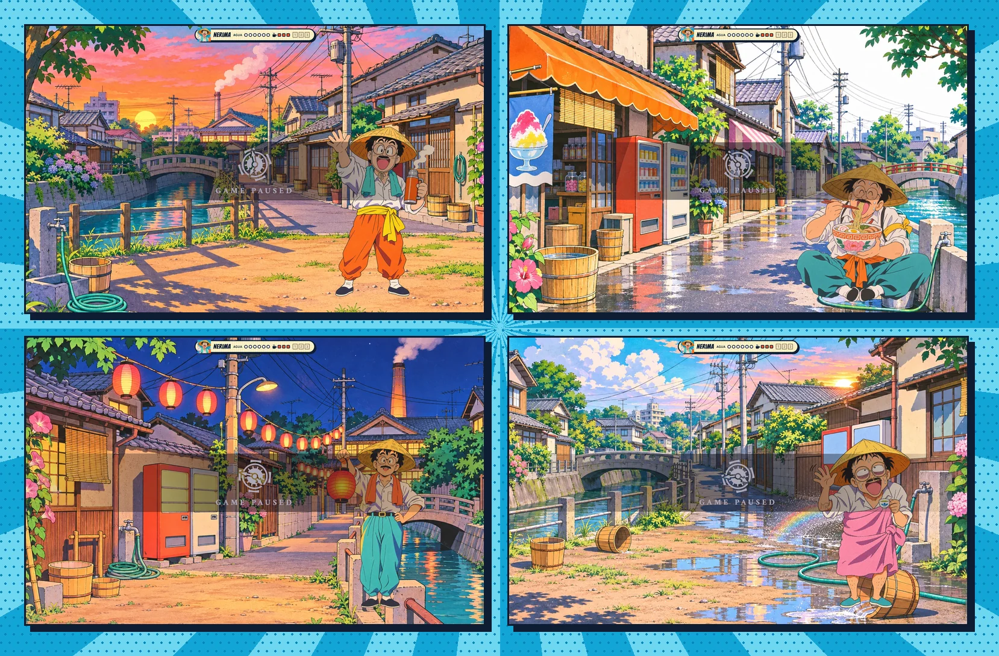
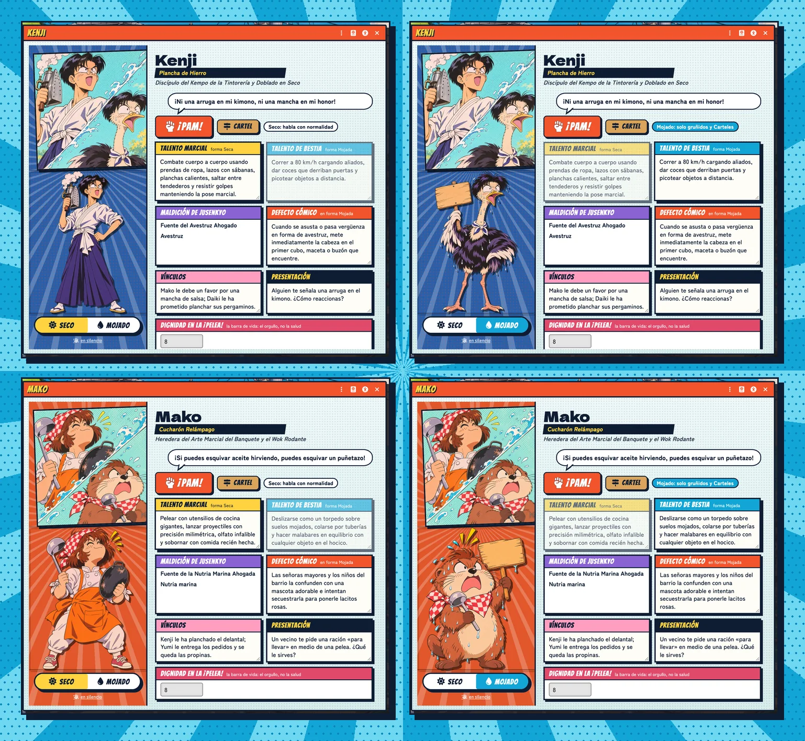
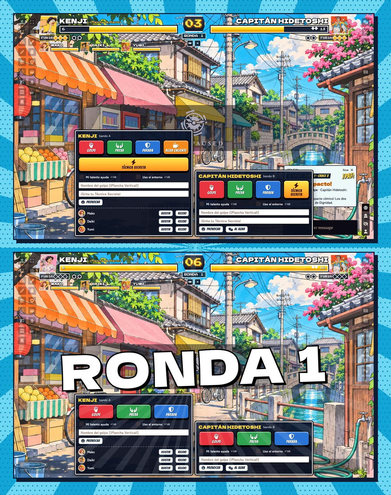
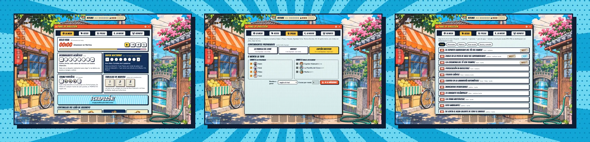
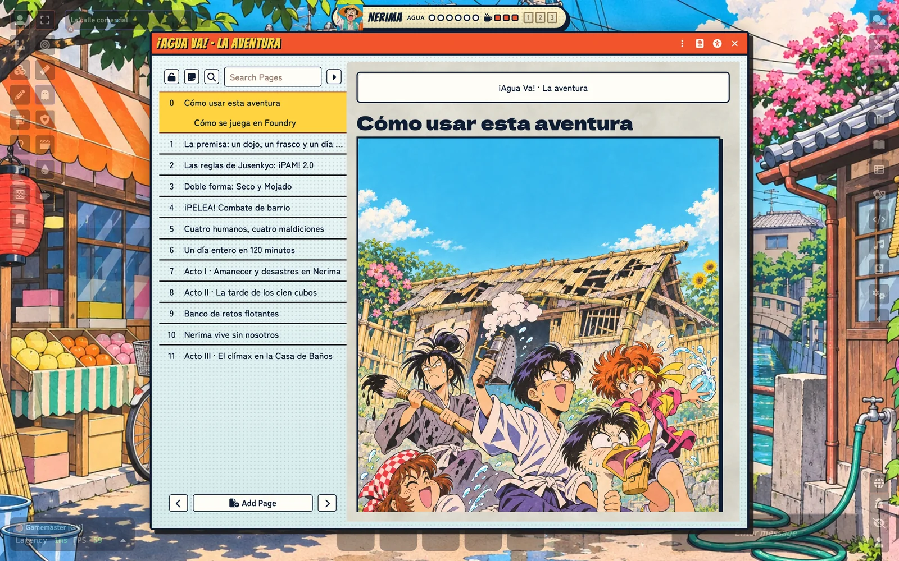
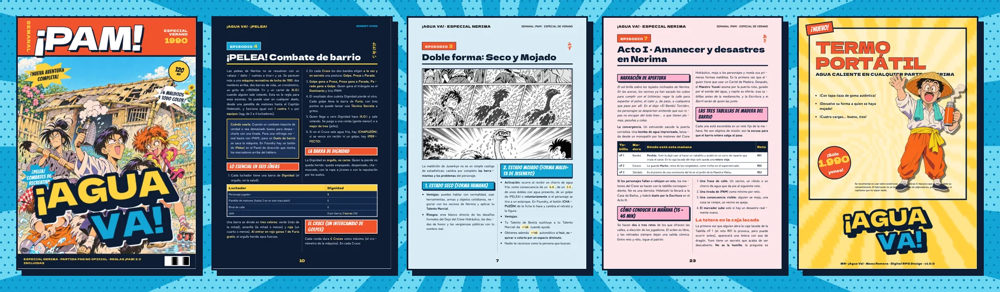

<p align="center">
  
</p>

<p align="center">
  <a href="https://github.com/ManuRomera"></a>
  <a href="https://github.com/ManuRomera/mr-agua-va/releases/latest"></a>
  <a href="https://github.com/ManuRomera/mr-agua-va/releases"></a>
  
  
  
</p>

<p align="center">
  <a href="https://github.com/ManuRomera/mr-agua-va/releases/latest/download/MR-Agua-Va.pdf"></a>
  <a href="https://github.com/ManuRomera/mr-agua-va/releases/latest/download/mr-agua-va.zip"></a>
</p>

# MR- ¡Agua Va!

Mini sistema y aventura de inicio para **Foundry VTT**: una comedia de enredos acuáticos y artes marciales en el barrio de Nerima, Tokio, en pleno verano de los años 90. Cuatro alumnos de un dojo ruinoso, **malditos por unas sales de baño de Jusenkyo**, se vuelven animales con agua fría y personas con agua caliente mientras corren por el barrio el día del Gran Remojo de Verano para reunir **tres tablillas de madera antes de la medianoche** y salvar su gimnasio del pedante Capitán Hidetoshi.

Es una partida **cachonda y desenfadada**, para dos a cuatro jugadores y quien dirige, de **120 minutos**, y un sistema ligero que solo pretende poner fácil el reírse. Todo —sistema, aventura y PDF— tiene el aspecto de un **especial de revista de anime de 1990**: cel pintado, tramas de puntos, viñetas con sombra dura, globos y onomatopeyas.

<p align="center"></p>

## Cuatro humanos, cuatro maldiciones

Kenji («Plancha de Hierro», avestruz con gafas), Mako («Cucharón Relámpago», nutria con pañuelo de chef), Daiki («Pincel Cortante», cabra que se come los contratos) y Yumi («Rueda de Fuego», macaco repartidor). Cada ficha tiene retrato y figura **en las dos formas**, un interruptor **SECO / MOJADO** y una sección privada «Solo para ti» con su secreto vergonzoso.

<p align="center"></p>

## ¡PAM! 2.0: dobles con consecuencias

2d6 (hasta 4d6), suman los dos mejores. Pero los **dobles se buscan en todos los dados**: dobles altos (4-5-6) = **Caos de Nerima** (un gag a tu favor); dobles bajos (1-2-3) = **Pifia Cómica** (¡CHAPUZÓN! o desastre, aunque salga bien). Si hay de los dos, manda el Caos; con tu Talento, los dobles de 3 también son Caos; y si pediste ayuda, la Pifia se la lleva el ayudante.

## Doble forma, Carteles de Madera y Termo

Mojarse (**¡CHAPUZÓN!**) cambia el retrato y la figura —también los tokens ya colocados en escena— y el personaje **solo puede gruñir y levantar Carteles de Madera de cuatro palabras** (el botón *Cartel* los pone en el chat; el **Vapor Nocturno** de la Casa de Baños los va recortando hasta una sola palabra). Para volver a ser persona hace falta agua caliente: una fuente de calor de la escena o una carga del **Termo Portátil**.

## ¡PELEA!: combates de recreativa

La novedad del sistema: una regla de **combate de barrio al estilo de las máquinas de lucha 1 contra 1 y por equipos (*tag*)**. Arriba de la pantalla aparecen los **nombres, los retratos, las barras de vida (la Dignidad: orgullo, no salud), la Furia, el cronómetro y las rondas**; abajo, el mando de cada jugador.

- **Golpe > Presa > Parada > Golpe**, elegidos a la vez y en secreto; quien gana el triángulo tira ¡PAM! y el resultado dice la Dignidad que pierde el rival (1 · 2 y ¡CHAPUZÓN! · 3 · 4). **Parada contra Parada**: sin tirada ni daño, chocan las espaldas y +1 de Furia a cada uno.
- **Furia** (ataque o escudo): con tres puntos, una **Técnica Secreta** a gritos, vinculada a un oficio normal («¡Kempo de la Plancha Voladora!»); o una **Evasión Ridícula** que anula cualquier ataque; o **peinarse** en pleno caos y recobrar Dignidad.
- **Provocación**: una pulla a la cara sobre el defecto o el secreto del rival; si hace gracia, no puede Parar este Cruce.
- **Entorno** (+1d6 por usar un cubo, una manguera, una tetera…), **asistencia** y **relevo** en equipos, **¡PERFECTO!** (regala una carga de Termo), **¡TIEMPO!** y **¡K.O.!** con quien cae decidiendo cómo sale volando.
- **Equipos con relevo dinámico:** quien espera en el banquillo ve sus botones en gris y puede **pedir el relevo**; el luchador activo elige a quién da entrada. **Los mandos de los enemigos solo los ve el máster.**
- **Jefe Final en un solo round:** el Capitán Hidetoshi tiene una barra de 16 en dos fases (cañón de agua con salpicadura, y cañón roto en furia máxima), aísla a quien empapa y lanza el **Torrente Olímpico** contra el banquillo, que tiene unos segundos para **esquivar** con un botón que tiembla en pantalla (QTE).
- **Vapor 6:** el edificio tiembla y quedan **2 Cruces** para vencer al jefe o cerrar una válvula; si no, explota (Final C).

<p align="center"></p>

## El gestor de la partida

El **Panel de dirección** lleva el reloj real de 120 minutos (y avisa cuando toca cortinilla), los marcadores de **Desbarajuste Acuático** (0–6) y **Vapor Nocturno** (0–6), el **Termo**, las **tres tablillas**, las cuatro cortinillas del Guía de Jusenkyo, los **18 retos flotantes**, la máquina de ¡PELEA! con sus contendientes, la noche en la Casa de Baños (tuberías cruzadas, tres vías de información, cuatro finales) y el reparto. Una **cartela** flotante enseña a todos los jugadores la hora del día y los marcadores.

<p align="center"></p>

## La aventura, completa en Foundry

Se instala sola en un mundo vacío: 17 decorados, los cuatro personajes malditos, rivales y vecinos, y los diarios de la aventura, la chuleta y las reglas, con todas sus láminas.

<p align="center"></p>

## El PDF: un especial de revista

El libro de la aventura va maquetado como un especial de la revista «¡PAM!» (B5): portada, índice, **pantalla de versus**, el capítulo de ¡PELEA! en papel de recreativa, láminas a color al empezar cada acto, fichas de personaje con sus dos formas, los retos en tarjetas, cameos en tres pasos, los cuatro malditos de un vistazo con la guía de «Solo para ti», encuesta del lector y un anuncio del Termo Portátil en la contraportada. Está en cada [versión publicada](https://github.com/ManuRomera/mr-agua-va/releases/latest).

<p align="center"></p>

## Lo de siempre

Accesibilidad (tamaño de texto, alto contraste, fuente legible, sin movimiento, modo oscuro), seguridad en la sesión (Pausa, Velo y Tarjeta X anónimas), memoria de ventanas, lupa sobre las imágenes, diagnóstico y créditos en Ajustes.

## Descargas

| Qué | Enlace directo |
|---|---|
| **PDF de la aventura** (revista B5) | [MR-Agua-Va.pdf](https://github.com/ManuRomera/mr-agua-va/releases/latest/download/MR-Agua-Va.pdf) |
| Sistema para Foundry (zip) | [mr-agua-va.zip](https://github.com/ManuRomera/mr-agua-va/releases/latest/download/mr-agua-va.zip) |
| Manifiesto para instalar desde Foundry | `https://github.com/ManuRomera/mr-agua-va/releases/latest/download/system.json` |
| Todas las versiones | [Releases](https://github.com/ManuRomera/mr-agua-va/releases) |

## Instalación

En Foundry: **Sistemas de juego → Instalar sistema** y pega el manifiesto:

```
https://github.com/ManuRomera/mr-agua-va/releases/latest/download/system.json
```

Crea un mundo con este sistema y entra como GM: la aventura se importa sola.

## Créditos

Aventura, sistema y dirección artística: Manu Romera. Arte generado con IA para esta partida a partir de diseños propios. Tipografías Dela Gothic One, Zen Maru Gothic, Bangers y Press Start 2P (SIL OFL 1.1). Partida fan, original y no oficial, inspirada en las comedias de artes marciales de los años 90; sin ánimo de lucro. Más detalles en [NOTICE.md](NOTICE.md).
